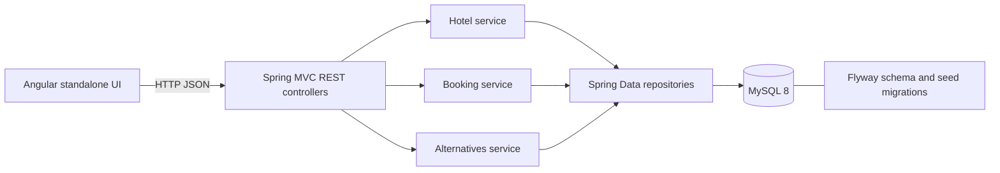

# StayWise design and engineering notes

## 1. Overview and goals

StayWise is a hotel discovery and reservation portal for fictional Indian properties. It aims to make a short booking journey understandable: search by city and dates, compare availability and prices, reserve one room, and retrieve or cancel a reservation later. Its signature Smart Alternatives experience helps a guest continue when dates are sold out.

The implementation includes nine fictional stays across eight cities, per-night inventory, a Spring REST API, an Angular single-page application, four Flyway migrations, original SVG property art, tests, and run/demo documentation. It intentionally excludes authentication, payments, guest counts, multiple room categories, reviews, and an administration interface.

## 2. Architecture

Controllers bind and validate requests, services own business rules and transaction boundaries, repositories express persistence queries, and DTO records keep JPA entities inside the backend. Feature-oriented packages put each controller/service/repository group near its domain. This keeps responsibilities visible without introducing extra abstraction layers for a small application.

A booking request is validated against the Asia/Kolkata clock, the hotel is loaded, the requested hotel-night rows are locked in date order, capacity is checked, inventory is incremented, the server calculates the amount, and the booking is saved. The single transaction commits both inventory and reservation data or rolls them back together.

Angular routes are standalone and lazy-loaded. Typed API services keep HTTP details out of page components; reusable UI components own repeated controls and presentation. Search criteria live in query parameters, so a results page can be shared or refreshed. Signals cover local view state. NgRx would add action/reducer/effect and selector machinery for state that is currently local to a page or already represented by the URL and API, so it was not added.

## 3. Database design

See the [entity diagram](docs/er-diagram.md) and authoritative DDL in `backend/src/main/resources/db/migration/V1__schema.sql`.

- `hotels` stores the catalog, unique slug, current nightly rate, and room capacity. A city index supports filtering.
- `amenities` and `hotel_amenities` represent the catalog and its many-to-many property features. The join table's composite primary key also prevents duplicate amenity links.
- `room_availability` has one row per hotel and calendar night, with composite primary key `(hotel_id, stay_date)`, a capacity snapshot, and booked count. That key supports exact date-range reads and locking; the hotel foreign key and checks guard invalid inventory values.
- `bookings` records the guest, stay dates, status, amount, and nightly-rate snapshot. A unique reference prevents duplicate public identifiers; the hotel foreign key and checks protect dates, amount, nights, and status. Indexes support email matching and hotel/date booking lookups.

Per-night inventory makes a multi-night request a clear set of rows that can be locked and checked. `capacity` snapshots the hotel's room count so the capacity guard is local to the inventory row. Booking rows snapshot the rate because changing a catalog price must not rewrite a confirmed guest's price. Money uses `DECIMAL`; Java uses `BigDecimal`, never floating point. `CHECK` constraints complement service validation and the transaction logic.

V1 defines the schema, V2 seeds nine fictional hotels and amenities, V3 creates the inclusive 366-day availability window, and V4 reserves sample nights and inserts matching demo bookings. Flyway applies these once per database. The scheduler extends the rolling inventory window idempotently as dates advance.

## 4. API design

All API routes are rooted at `/api`.

| Method | Endpoint | Purpose |
|---|---|---|
| GET | `/cities` | List destination cities |
| GET | `/hotels?city=&checkIn=&checkOut=` | Search stays; dates are ISO `YYYY-MM-DD` |
| GET | `/hotels/{id}?checkIn=&checkOut=` | Hotel detail and optional availability |
| GET | `/hotels/slug/{slug}?checkIn=&checkOut=` | Same detail by readable route slug |
| GET | `/hotels/{id}/quote?checkIn=&checkOut=` | Server-calculated price breakdown |
| GET | `/hotels/{id}/alternatives?checkIn=&checkOut=` | Nearby date and same-city options |
| POST | `/bookings` | Create a one-room reservation (201) |
| POST | `/bookings/lookup` | Retrieve a booking using reference and email |
| POST | `/bookings/cancel` | Cancel a booking using reference and email |

Lookup and cancel use JSON request bodies so email addresses do not become URL parameters or browser-history entries. A successful quote resembles `{"nights":2,"pricePerNight":7800.00,"subtotal":15600.00,"total":15600.00,"currency":"INR"}`. Booking creation accepts `hotelId`, `guestName`, `guestEmail`, `checkIn`, and `checkOut`; clients cannot supply or override the price.

Errors have a stable JSON shape: timestamp, HTTP status, code, safe message, request path, and field errors. Validation and malformed input return 400; missing hotel/booking returns 404; sold-out and disallowed cancellation return 409; unexpected server failures return a generic 500 message and are logged server-side. A wrong reference and a wrong email both produce `BOOKING_NOT_FOUND`.

## 5. Booking logic

Dates use the half-open interval `[checkIn, checkOut)`: the arrival night is included and checkout morning is not. A stay from the 10th to the 12th is two nights, and another guest can check in on the 12th. The injected `Clock` uses `Asia/Kolkata`; check-in can be today, must not be in the past, must be no more than 365 days ahead, and a stay can be 1–30 nights.

The price formula is `nights × pricePerNight`, returned as an INR breakdown. There are no taxes or additional fees. A booking reserves one room for every occupied night. The create flow locks those rows in ascending date order, rejects a missing inventory row or any full night, increments each row, creates a secure `SW-` reference, and stores the confirmed booking and price snapshot in one transaction. The DB capacity constraint provides an additional guard.

Cancellation first matches normalized reference and trimmed, lowercased email. It rejects cancellation on or after check-in; otherwise it locks the same ordered night rows, decrements each count, and marks the booking cancelled within one transaction. If already cancelled, it returns that booking without releasing inventory again.

## 6. Simultaneous bookings and the last-room problem

If two requests both read the last room as available and then independently increment a count, both could be confirmed. `PESSIMISTIC_WRITE` locks each requested `room_availability` row until transaction completion. Requests for overlapping stays therefore serialize on shared nights. The query orders dates ascending so different overlapping multi-night requests acquire shared rows in a consistent order, reducing deadlock risk. The transaction checks capacity after it owns the locks; the database check constraint prevents `booked_rooms > capacity` even if another code path is introduced.

The repository includes Testcontainers MySQL integration tests and `ConcurrentBookingIT` for racing requests. They were run against MySQL in the checked environment; both race scenarios passed, including repeat runs described in the test section below.

Alternatives have different trade-offs. Optimistic locking with `@Version` needs conflict retries and can cause retry storms around popular dates. An atomic conditional update (`booked_rooms = booked_rooms + 1 WHERE booked_rooms < capacity`) can be efficient but must update every night and undo partial success safely. Redis/distributed locks add an operational dependency and lease/failure semantics. A queue serializes work but increases latency and infrastructure. `SERIALIZABLE` isolation may reduce throughput and cause broader contention. Ordered row locks are easy to reason about for this small MySQL app.

At larger scale, search reads can use replicas and cache short-lived availability snapshots while final booking still checks the primary database under lock. Inventory writes can be partitioned by hotel or date range, with each booking transaction routed to one inventory owner. A distributed reservation workflow would need explicit expiry/compensation and idempotency semantics.

## 7. Smart Alternatives

The feature addresses the dead end shown by a sold-out search result. For the same hotel it scans nearby start dates within ±14 days, keeps the requested night count, excludes the sold-out start, respects the present/rolling-window limits, and returns at most four closest available options. Equal-distance dates prefer the earlier start. For other hotels, it checks same-city inventory for the exact interval and returns up to four available stays ranked by nightly price then name. The UI renders date choices and alternate property cards; selecting one reruns the search or opens that stay.

The service reads the same-hotel scan window in a bounded query and checks candidate ranges in memory, then reads the requested window for hotels in one query and groups by hotel/date. For `d` candidate starts, `n` nights, and `h` hotels, work is O(d·n + h·n), with no query per candidate. Missing inventory means unavailable. Suggestions are snapshots and may become stale; booking always rechecks under locks. Alternatives do not reserve rooms.

## 8. Frontend design

Routes cover home, hotel results, hotel detail, booking, confirmation, and booking management. API services expose typed hotel, quote, alternatives, and booking calls. URL parameters preserve city and dates. HTTP interceptors track loading and surface safe errors; forms display field-level messages. Shared UI includes date range selection, buttons, badges, skeletons, error notices, and Smart Alternatives.

The visual system uses navy `#233251`, gold `#BE9965`, Playfair Display for headings, and self-hosted Source Sans 3 for body/UI. SCSS tokens define color, spacing, borders, and typography. Lucide provides a consistent SVG icon set. The UI is responsive with mobile-specific layouts, semantic landmarks/labels, visible keyboard focus, live status/error text, reduced-motion support, and an accessible keyboard-operated date picker and native cancellation dialog. The supplied logo is preserved; a script derives transparent variants and favicon assets.

## 9. Design decisions and trade-offs

| Decision | Alternative | Reason | Trade-off |
|---|---|---|---|
| One availability row per night | Store only booking intervals | Simple exact-night locking and room-left calculation | More rows and rolling-window maintenance |
| Pessimistic ordered row locks | Optimistic retries | Clear correctness for scarce inventory | Contending requests wait |
| Server owns totals | Client-side price math | Prevents stale/tampered totals | Quote requires an API call |
| POST lookup/cancel | Put lookup fields in URL | Keeps email out of route/history | Not a cacheable GET |
| Angular signals and URL state | Global NgRx store | Fits local state and shareable criteria | No centralized event history |
| Original SVG hotel art | Remote stock photos | No licenses/network dependency, consistent appearance | Less photographic realism |

## 10. Assumptions

- All properties are fictional and INR is the only currency.
- Asia/Kolkata defines “today”; check-in may be today, is limited to +365 days, and the seeded availability window includes today through +365.
- Maximum stay is 30 nights; exactly one room and one room category are supported per reservation.
- Totals are nightly rate times nights, with no tax or fee calculations; confirmed bookings snapshot the rate.
- Email matching is trimmed and case-insensitive. Guests prove lookup authority using both reference and email because the application has no accounts.
- Cancellation is allowed only before check-in and repeat cancellation is idempotent.
- Demo dates and pre-booked reservations are relative to the database's current date.

## 11. Security and privacy notes

The committed `.env.example` and `application-example.yml` contain local placeholders only. `.env` and real `application-*.yml` files are ignored. Request DTOs use Bean Validation, data access uses JPA parameters, error responses do not expose stack traces or SQL, and lookup avoids revealing whether a reference or email alone matched. Booking log lines mask guest email. CORS permits the configured frontend origin; actuator exposes health only. Production dependency audit is clean; the full npm audit currently reports 16 moderate findings in development tooling transitive dependencies, with no compatible non-major fix offered by npm for the pinned Angular CLI version.

Before production use, add HTTPS, rate limiting and abuse monitoring, email verification or account authentication, secret-manager-backed credentials, operational logging/metrics, and a privacy/retention policy. The reference plus email check is a lightweight demo verification mechanism, not strong account security.

## 12. Testing strategy

Backend unit/controller coverage includes pricing, date validation, hotel controller responses, booking service behavior, Smart Alternatives, and rolling inventory scheduling. `mvn clean verify` passed 21 tests: 19 Surefire tests and 2 Testcontainers concurrency tests. A separate failsafe run repeated both concurrency scenarios twice, adding 4 passing invocations. Fresh Testcontainers databases applied Flyway migrations V1–V4; the Compose MySQL database also started successfully and received the migrations. The API health endpoint and seeded availability cases were checked, and a browser reservation was created and cancelled against the running app.

Frontend Vitest coverage exercises INR/night-count formatting, date-range boundaries, safe interceptor mapping, and booking form validation (9 tests). Production compilation checks strict Angular templates and emits lazy route chunks. Chrome screenshots document the browser path from search through cancellation, including a mobile home layout. axe-core reported no WCAG rule violations on desktop home, results, and hotel details. Lighthouse against the production build reported accessibility 100, best practices 96, and performance 70 using a local static server; the performance score is a diagnostic baseline because that server does not model production compression, caching, or hosting. Screen-reader and cross-browser checks remain outstanding. `npm test -- --watch=false` passed all 9 tests; `npm run build -- --configuration=production` passed without build warnings.

## 13. Limitations and future improvements

- Screen-reader and cross-browser checks have not been run. Automated axe results cover three desktop routes and do not certify overall accessibility; Lighthouse performance was measured with a local static server rather than a production host.
- Add integration tests for back-to-back stays, cancellation/rebooking, duplicate cancellation, and races, and run them repeatedly on MySQL.
- Add more frontend specs for date constraints and key guest journeys, then run responsive and assistive-technology checks.
- Payments, email confirmations, multiple room categories, guest counts, reviews, idempotency keys, rate limiting, internationalization, observability, and CI/CD remain outside the current implementation.
- Total implementation hours were not tracked reliably, so no numeric estimate is claimed. AI coding assistance was used significantly for implementation, documentation, and test work. The human submitter remains responsible for reviewing and understanding the repository before presenting it.
