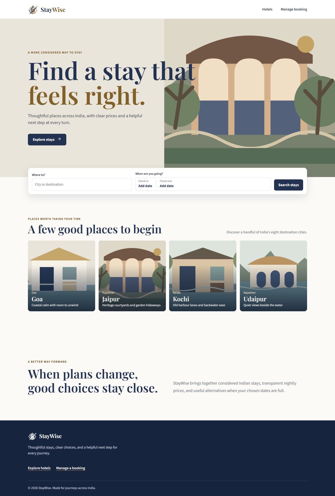

<p align="center">
  
</p>

<h1 align="center">StayWise</h1>

<p align="center"><strong>Thoughtful stays across India.</strong><br />A hotel discovery and booking portal with clear prices, live availability, and helpful alternatives.</p>

<p align="center">
  <a href="docs/demo.md">Demo walkthrough</a> ·
  <a href="DESIGN.md">Design notes</a> ·
  <a href="docs/er-diagram.md">Database diagram</a> ·
  <a href="docs/CREDITS.md">Asset credits</a>
</p>

<p align="center">
  <a href="docs/screenshots/README.md">Screenshots</a> ·
  <a href="#quick-start">Quick start</a> ·
  <a href="#verification">Verification</a>
</p>

---

<p align="center">
  <a href="docs/screenshots/home-desktop.png"></a>
</p>

> **Project demo:** All hotels and reservations are fictional. This app does not process payments and does not provide production account security.

## What you can do

- Search stays in eight Indian cities using an accessible date-range picker.
- Compare nine fictional hotels, amenities, room availability, and nightly prices.
- View hotel details and server-calculated booking quotes.
- Reserve one room per booking; the backend locks inventory to protect the last room.
- Find a reservation or cancel it using its reference and booking email.
- Continue a sold-out search with nearby dates or available hotels in the same city.

## Quick start

### Requirements

- Java 17 or newer
- Node.js 20.19+, 22.12+, or 24+, with npm
- Docker Desktop / Docker Engine with Docker Compose, or a local MySQL 8 database

### 1. Start the database

From the repository root, copy the example environment file and launch MySQL:

```powershell
Copy-Item .env.example .env
docker compose up -d
```

Compose exposes MySQL on host port `3307`. The `.env` file contains local credentials only; keep real secrets out of version control.

### 2. Start the backend

In a second terminal:

```powershell
cd backend
.\mvnw.cmd spring-boot:run
```

Flyway creates the schema and loads the fictional hotel catalog, nightly inventory, and demo availability. The service uses `Asia/Kolkata` for booking dates.

### 3. Start the frontend

In a third terminal:

```powershell
cd frontend
npm install
npm start
```

Open the portal at **http://localhost:4200**.

<details>
<summary>macOS / Linux commands</summary>

```sh
cp .env.example .env
docker compose up -d
```

In separate terminals:

```sh
cd backend && ./mvnw spring-boot:run
```

```sh
cd frontend && npm install && npm start
```

</details>

### Local service links

| Service | Address |
|---|---|
| StayWise portal | [localhost:4200](http://localhost:4200) |
| Swagger API docs | [localhost:8080/swagger-ui.html](http://localhost:8080/swagger-ui.html) |
| Backend health | [localhost:8080/actuator/health](http://localhost:8080/actuator/health) |

## Try the demo scenarios

Seeded availability is relative to the database date, so the cases remain useful over time:

| Hotel | Dates from today | Result |
|---|---:|---|
| Aravali Palace Heritage · Jaipur | +21 to +24 days | Sold out; explore alternatives |
| Sea Glass House · Mumbai | +28 to +31 days | One room left |
| Monsoon Courtyard · Goa | +35 to +38 days | Two rooms left |

See the [step-by-step walkthrough](docs/demo.md) for the full search, reservation, and cancellation path.

## Technology

| Layer | Tools |
|---|---|
| Frontend | Angular 21, TypeScript, SCSS, RxJS, Vitest |
| Backend | Java 17 target, Spring Boot 3.5.11, Spring MVC, Spring Data JPA, Bean Validation |
| Database | MySQL 8, InnoDB, Flyway migrations |
| UI | Lucide icons, self-hosted Playfair Display and Source Sans 3, original SVG hotel art |
| Testing | JUnit, Testcontainers, Vitest, Chrome, axe-core, Lighthouse |

## API overview

All API routes use the `/api` prefix.

| Method | Route | Purpose |
|---|---|---|
| `GET` | `/api/cities` | List destination cities |
| `GET` | `/api/hotels?city=&checkIn=&checkOut=` | Search hotels and availability |
| `GET` | `/api/hotels/{id}` or `/api/hotels/slug/{slug}` | Hotel details |
| `GET` | `/api/hotels/{id}/quote` | Get a server-calculated price |
| `GET` | `/api/hotels/{id}/alternatives` | Find nearby dates and same-city stays |
| `POST` | `/api/bookings` | Create a reservation |
| `POST` | `/api/bookings/lookup` | Look up a reservation by reference and email |
| `POST` | `/api/bookings/cancel` | Cancel a reservation |

Lookup and cancellation accept email in the request body so it does not appear in the URL or browser history. See the running [Swagger UI](http://localhost:8080/swagger-ui.html) for request and response schemas.

## Development and verification

Run backend checks from `backend`:

```powershell
.\mvnw.cmd clean verify
```

The Maven verification includes unit, controller, MySQL integration, and concurrency tests; Testcontainers requires Docker. To run the concurrency test class separately:

```powershell
.\mvnw.cmd -Dit.test=ConcurrentBookingIT verify
```

Run frontend checks from `frontend`:

```sh
npm test -- --watch=false
npm run build -- --configuration=production
```

### Latest checked results

- Backend: **21 tests passed** in `mvn clean verify`; both concurrency cases were also repeated twice, with **4 additional passes**.
- Frontend: **9 tests passed**; production build succeeded.
- Browser: booking, confirmation, lookup, and cancellation journey completed in Chrome.
- Accessibility: axe-core reported **0 violations** on desktop home, search results, and hotel details.
- Lighthouse: **100 accessibility**, **96 best practices**, **70 performance** on the production build. Performance is a local diagnostic score; the test server does not reproduce production hosting, compression, or caching.
- Dependencies: `npm audit --omit=dev` found **0 production vulnerabilities**. Full audit reports **16 moderate development-tool findings** in the Angular CLI dependency tree; npm's suggested remediation downgrades Angular CLI to 16, so it was not applied to this Angular 21 project.

## Project map

```text
backend/                 Spring Boot API, domain services, migrations, tests
frontend/                Angular application, assets, and frontend tests
docs/demo.md              Guided product walkthrough
docs/screenshots/         Desktop and mobile app captures
docs/er-diagram.md        Database entity relationship diagram
docs/CREDITS.md           Logo and illustration credits
DESIGN.md                 Architecture, decisions, trade-offs, and limits
```

## Product rules and scope

Stays use the half-open interval `[checkIn, checkOut)`: checkout day is not charged as a night. Check-in is allowed today; stays are 1–30 nights and can be booked up to 365 days ahead. Prices are in INR and calculated as nightly rate × nights, with no taxes or fees. Each reservation books one room and may be cancelled before check-in.

This is a portfolio/demo project. Authentication, payments, email notifications, guest counts, multiple room types, reviews, rate limiting, and CI/CD are outside the current scope. Screen-reader testing and performance measurement on a production host have not been performed. AI coding assistance was used; implementation time was not tracked.

For technical detail, see [DESIGN.md](DESIGN.md), [asset credits](docs/CREDITS.md), and the [demo walkthrough](docs/demo.md).
