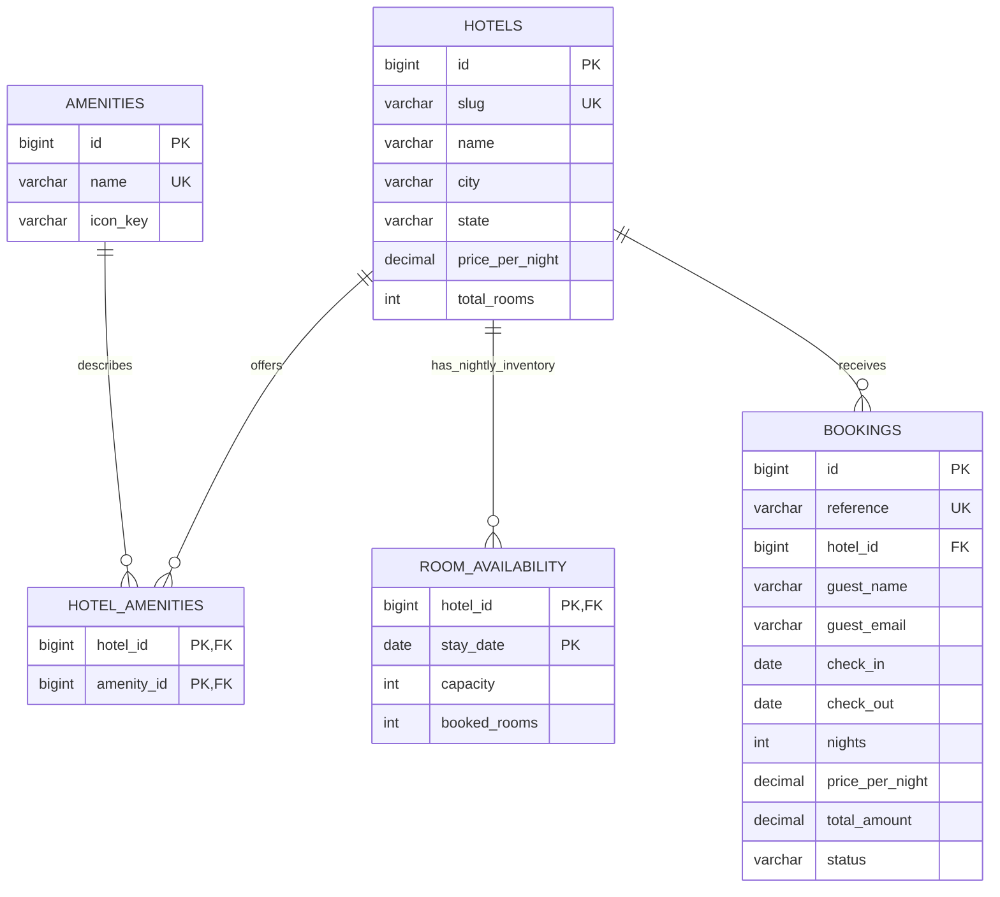

# StayWise entity relationship diagram

`HOTEL_AMENITIES` is the many-to-many join. `ROOM_AVAILABILITY` uses `(hotel_id, stay_date)` as a composite key so each room-night has independent capacity and booked count. Bookings keep the nightly price at creation time, preserving the amount quoted even if the catalog price changes later. The deployed DDL and constraints are in `backend/src/main/resources/db/migration/V1__schema.sql`.
